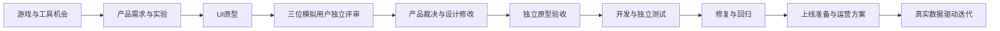

# AgentWorks

**可长期复用的海外产品多 Agent 团队。** 从游戏与工具机会研究，到产品定义、UI原型、独立评审、开发验收和运营迭代，保存每一步的交付与进度。

15 个固定角色，全部采用 **20 年资深从业者标准**。这是专业能力框架，不是真实履历；AI 用户评审明确标注模拟，真实用户与经营数据单独记录。

## 直接开始

在 Codex 中打开本仓库，告诉它：

> 使用 AgentWorks 查看当前项目，并从已保存的进度继续。

或新建项目：

> 使用 AgentWorks 新建一个海外产品项目，同时比较游戏和工具，按盈利证据挑选方向。

详细操作见 [使用指南](docs/使用指南.md)，角色与交接标准见 [协作约定](docs/协作约定.md)。

## 固定团队

| 角色 | 负责什么 |
|---|---|
| 总控负责人 | 任务协调、交付检查、阶段决策 |
| 海外市场研究员 | 游戏／工具机会、竞品与需求证据 |
| 产品负责人 | 最小需求、付费价值、反馈裁决 |
| 游戏策划与数值负责人 | 核心玩法、关卡、数值、可玩验证 |
| UI与交互设计负责人 | 视觉规范、使用流程、可操作原型 |
| 全栈与游戏开发工程师 | 代码实现、实际运行与缺陷修复 |
| 独立质量工程师 | 功能、视觉、异常和回归验收 |
| 海外增长运营负责人 | 渠道、内容、转化、留存实验 |
| 商业与盈利分析师 | 定价、收入成本、情景与投入分析 |
| 产品数据分析师 | 指标口径、真实数据、实验分析 |
| 海外本地化专家 | 目标地区语言、文案与使用习惯 |
| 发布与运行维护工程师 | 部署准备、监控、恢复方案 |
| 海外资深用户评审 | 品类熟练用户的模拟评审 |
| 海外新用户体验评审 | 用资深研究方法模拟首次使用 |
| 海外付费价值评审 | 价格理解、信任和价值的模拟评审 |

角色原始配置：`config/team.json`。可被 Codex 发现的角色：`.codex/agents/`。可复用技能：`.agents/skills/agentworks/`。

## 协作流程



六个工作流：`discovery → product → design → build → launch → growth`。运营从研究阶段就参与，阶段末有独立验收。结果待修改或阻塞时保留历史，补充输入后继续。

## 两种使用方式

**Codex 对话内协作**：总控读取项目状态，为专业子 agent 导出任务包，汇总并保存结果。可利用当前会话已经连接的浏览器、图片、设计或开发工具。

**本机运行器**：通过已登录的 Codex CLI 启动独立角色进程，自动处理依赖、结构化交付、阶段状态、有限重试和日志。独立只读任务可以并行，可写任务独占执行。

本地要求：macOS/Linux、Python 3.9+、Git；自动执行需要 Codex CLI 及有效登录。运行器无额外 Python 包依赖。

```bash
python3 -m agentworks doctor
python3 -m agentworks create my-product --title "海外产品选题" --kind compare
python3 -m agentworks plan my-product discovery
python3 -m agentworks run my-product
```

最后一条预览就绪任务。实际调用模型：

```bash
python3 -m agentworks run my-product --execute --max-tasks 2
python3 -m agentworks status my-product
python3 -m agentworks continue my-product --execute --max-tasks 3
```

执行会使用本机账号的模型额度。调用数、并发、超时和重试有上限；没有精确的金额限额功能。

## 持久保存与恢复

- Git 保存角色、流程、程序和文档，能回退版本并跨项目复用。
- `.agentworks/state.sqlite3` 保存各项目的任务、事件和配置快照。
- `.agentworks/projects/` 保存简报、项目记忆、输入资料、原型、代码和运行报告。
- `export` / `restore` 备份并恢复项目，目标必须为空，避免覆盖现有工作。
- `.agentworks/` 默认不进入 Git；产品数据需要单独备份。

```bash
python3 -m agentworks note my-product "记录用户确认的目标、约束与决定"
python3 -m agentworks export my-product /备份目录/my-product.zip
python3 -m agentworks --data-dir /新数据目录 restore /备份目录/my-product.zip
```

## 当前能力边界

这是可运行的**本地版本**。配置与进度跨聊天保存，已完成任务可以交接与续作；未安装云端或开机常驻服务，关机后本机不会继续工作。

图像生成、浏览器、游戏引擎、商业数据和运营账号按产品需要连接；未连接的工具不会凭空可用。launch 交付上线准备，实际外部发布需要已授权的工具与环境。growth 使用真实数据；缺数据会明确阻塞。

角色配置不能保证模型实际具备人类20年的经验，团队结果仍需证据和验收。

## 验证与维护

```bash
python3 scripts/sync_agents.py --check
python3 -m unittest discover -s tests -v
python3 -m agentworks doctor
```

覆盖任务依赖、验收阻塞、重试上限、并发与可写互斥、跨会话恢复、项目隔离、过期交付识别、备份恢复和产物路径检查。可选的真实模型交接检查：

```bash
python3 scripts/smoke_codex.py --execute
```

它只让两个真实角色处理本地测试简报，不进行市场调研或运营。验证结果保存在 `.agentworks/verification/`。

## 配置依据

- [Codex 自定义角色](https://learn.chatgpt.com/docs/agent-configuration/subagents)
- [Codex 项目规则与技能](https://learn.chatgpt.com/docs/customization/overview)
- [Codex 非交互执行](https://learn.chatgpt.com/docs/non-interactive-mode)

按本机 Codex CLI 0.162.0-alpha.2 的实际参数完成连通性检查。使用其他版本时先运行 doctor；配置格式可能随客户端变化。
