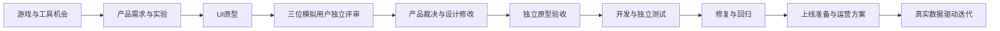

# AgentWorks

**在 Codex 桌面端和 Claude 桌面端 Code 模式中，通过聊天协作的海外产品团队。**

15 个固定角色、6 个阶段，从游戏与工具选题到产品、设计、独立评审、开发验收和运营迭代。所有角色采用20年资深从业者标准，这是专业判断框架，不是真实履历；AI用户评审明确标注模拟。

## 直接开始

在 Codex 桌面端打开 AgentWorks 本地项目，或在 Claude 桌面端的 Code 模式选择同一份本地文件夹，然后说：

> 使用 AgentWorks 查看当前项目，从已保存进度继续。

新项目可以说：

> 使用 AgentWorks 新建海外产品项目，先比较游戏和工具，再按盈利证据选择方向。

你只需要聊天。团队使用当前桌面端的原生子 Agent 和工具，自动保存项目状态；不需要独立模型命令行、终端启动步骤或额外模型登录。

[桌面使用指南](docs/使用指南.md) · [两桌面端共用说明](docs/跨环境使用.md) · [验收记录](docs/验收记录.md)

## 一份团队配置，两个桌面入口

| 内容 | Codex 桌面端 | Claude 桌面端 Code 模式 |
|---|---|---|
| 共用规则 | `AGENTS.md` | `CLAUDE.md` 导入同一规则 |
| 自动生成的原生角色 | `.codex/agents/*.toml` | `.claude/agents/agentworks-*.md` |
| 启动方式 | 自然语言；可选 `$agentworks` | 自然语言；可选 `/agentworks` |
| 项目进度 | 同一份 `.agentworks/` | 同一份 `.agentworks/` |

角色只维护 `config/team.json`，流程只维护 `config/workflows.json`。两个平台的原生角色与技能自动同步，无需分别维护。

## 固定团队

| 角色 | 负责什么 |
|---|---|
| 总控负责人 | 任务协调、交付检查、阶段决策 |
| 海外市场研究员 | 游戏／工具机会、竞品与需求证据 |
| 产品负责人 | 最小需求、付费价值、反馈裁决 |
| 游戏策划与数值负责人 | 核心玩法、关卡、数值、可玩验证 |
| UI与交互设计负责人 | 视觉规范、使用流程、可操作原型 |
| 全栈与游戏开发工程师 | 代码实现、实际运行与缺陷修复 |
| 独立质量工程师 | 功能、视觉、异常和回归验收 |
| 海外增长运营负责人 | 渠道、内容、转化、留存实验 |
| 商业与盈利分析师 | 定价、收入成本、情景与投入分析 |
| 产品数据分析师 | 指标口径、真实数据、实验分析 |
| 海外本地化专家 | 目标地区语言、文案与使用习惯 |
| 发布与运行维护工程师 | 部署准备、监控、恢复方案 |
| 海外资深用户评审 | 品类熟练用户的模拟评审 |
| 海外新用户体验评审 | 用资深研究方法模拟首次使用 |
| 海外付费价值评审 | 价格理解、信任和价值的模拟评审 |

角色唯一来源：`config/team.json`。同步生成 `roles/` 通用角色卡、`.codex/agents/` 和 `.claude/agents/`。两桌面端共用 [团队运行手册](docs/团队运行手册.md)、工作流和项目记忆。

## 协作流程

六个工作流：`discovery → product → design → build → launch → growth`。运营从研究阶段就参与，阶段末有独立验收。结果待修改或阻塞时保留历史，补充输入后继续。

## 进度和交付长期保存

角色、流程、程序和说明进入 Git；每个产品的简报、记忆、任务状态、原型、代码和报告保存到 `.agentworks/`。

切换桌面端前先收齐当前批次交付，再打开同一份本地文件夹继续。原生子 Agent 开始前会登记任务，执行中不会被另一会话重复领取；中断后可以检查已有产物并恢复。工作树或另一台电脑需要明确连接或恢复原数据目录。

项目数据默认不进入 Git。你可以直接说“把这个项目备份到我指定的位置”，由 Agent 保存备份；恢复使用空目录，保留现有数据。

## 桌面内部支持

`agentworks.desktop.Workspace` 只管理本地项目状态、交付校验、重试和备份，不调用模型。由桌面 Agent 使用自己的代码工具调用，用户无需操作。内部模块使用 Python 标准库，当前支持 macOS/Linux，依赖 Python 3.9+ 和 Git。

模型、并发能力、浏览器、图像和外部服务使用当前桌面应用的设置与已连接工具。缺少必需能力时明确报告。当前没有常驻服务；不会在关闭应用后自行另启模型进程。真实发布、对外消息或投放仍按用户明确授权执行。

维护人员与 Agent 参考 [团队运行手册](docs/团队运行手册.md)、[桌面内部接口](docs/桌面内部接口.md) 和 [协作约定](docs/协作约定.md)。
